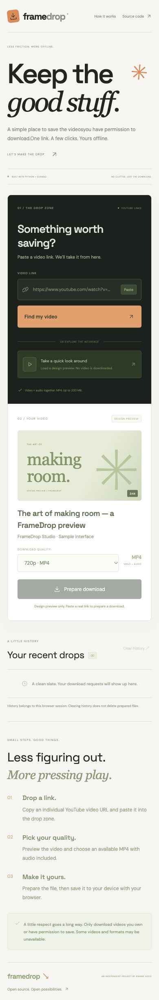

# FrameDrop — YouTube Downloader

[Hosted application](https://framedrop-0t1s.onrender.com) · Free Render service · Read the live-check limitation below
A rejuvenated Django downloader with a focused interface, video previews, available quality selection, background preparation, real progress, and browser file delivery.



## Run locally

Requires Python 3.10 or newer (tested on Python 3.14).

```sh
python3 -m venv .venv
source .venv/bin/activate
pip install -r requirements.txt
python manage.py migrate
python manage.py runserver 127.0.0.1:8001 --noreload
```

Open http://127.0.0.1:8001. Use **Take a quick look around** to explore the interface without fetching a video. This is explicitly a design preview: it does not download or simulate completed jobs.

For an actual download, paste an individual YouTube video URL, load its details, choose one of the returned MP4 formats, and prepare the file. Once ready, use **Save video to your device**. Download only videos you own or have permission to save.

## What changed

- Custom responsive interface replacing the original Bootstrap form.
- Metadata preview with title, creator, duration, and thumbnail.
- Quality choices based on available video-with-audio MP4 streams, not hard-coded resolution promises.
- Background processing, actual extractor progress when a byte estimate is known, and honest indeterminate progress otherwise.
- Session-owned save links and recent request history with ready, working, error, or expired states.
- Clear errors rather than uncaught server exceptions.
- Restricted YouTube URL parsing and server-approved format selection.
- Django 5.2 and yt-dlp replacing conflicting, outdated downloader dependencies.
- Generated databases, media, and Python cache files excluded from version control.

## Current scope

This is a **local, single-process portfolio application**. The thread pool has two workers and rejects additional jobs while both are busy. Jobs are kept in memory and disappear on restart. Sessions and history use SQLite in `data/`; without a persistent DJANGO_SECRET_KEY, sessions are also invalidated between server restarts. Prepared files are under `data/downloads/`, not in the static directory.

Completed and failed jobs older than one hour are cleaned when a new job starts. Interrupted jobs and orphan files from a restart require manual local cleanup while the server is stopped. History clearing only clears history; it does not delete files. The application enforces a 200 MB limit and supports individual videos only, not playlists or live streams.

Only MP4 streams that already include audio are exposed. Separate-stream merging, audio conversion, and FFmpeg integration are not implemented. Some videos may therefore have limited quality choices or no supported format. YouTube restrictions and extractor changes can prevent downloads. Current yt-dlp may need a supported JavaScript runtime and challenge solver for some YouTube extraction paths; this app does not bypass restrictions or automatically install those components. See the [yt-dlp documentation](https://github.com/yt-dlp/yt-dlp#dependencies).

The test suite mocks extraction and downloads; it does not fetch real videos. Successful tests do not guarantee availability of a particular YouTube video.

## Configuration and hosting

- `DJANGO_SECRET_KEY`: use a stable secret outside version control for persistent sessions.
- `DJANGO_DEBUG`: defaults to `1` for local development; set to `0` for deployment.
- `DJANGO_ALLOWED_HOSTS`: comma-separated allowed hosts, defaults to localhost/127.0.0.1/testserver.

Keep this version on localhost. Before public hosting add authentication, user quotas, rate limits, a persistent job queue, durable private storage, scheduled cleanup, HTTPS, and production settings/static-file serving. Do not scale this in-memory job registry across multiple workers. The current design is intended to demonstrate the workflow, not operate a public download service.

## Checks

```sh
python manage.py check
python manage.py test
```

Tests cover URL validation, CSRF, format filtering, session isolation, invalid requests, mocked worker completion, and browser attachment responses. Fonts come from Google Fonts; system fallbacks work offline. Live video thumbnails are loaded from YouTube's image CDN only after a successful preview.

## Full downloader deployment on Render

`render.yaml` defines a free Python web service, with a generated stable Django secret, HTTPS-only cookies, collected static assets, and one Gunicorn process with four request threads. The single process is required because the bounded download worker pool and job registry are process-local. Do not increase Gunicorn workers without first moving jobs into a shared queue. No browser design-preview shortcut replaces actual downloads.

Free Render services can sleep after inactivity. Temporary download files, sessions, and jobs are lost on restart or redeployment; failed jobs must be started again. This is a short-lived portfolio demo, not a durable download service. Upstream YouTube restrictions can prevent extraction from cloud IPs. Automated tests mock extraction and do not establish real-video availability. Only download videos you have permission to save.

To deploy, connect the Render integration, authorize access to this repository, and create the service from the blueprint. The blueprint requests the free plan only. Paid workers or persistent disks are not provisioned. Durable production processing would need shared job state, queue retries, private object storage, and abuse/resource controls.

### Live verification on November 4, 2026

The Render service started successfully with Python 3.13.8, database migrations, static assets, secure session cookies, and a single Gunicorn process. Its HTML and interface load publicly. A real lookup for the Blender Foundation’s Big Buck Bunny video was rejected by YouTube with “Sign in to confirm you’re not a bot.” The application reports that restriction honestly; a real hosted file download has not been verified. A healthy Render deployment does not establish that YouTube will allow video extraction from its network.

The full downloader implementation is deployed, including its bounded worker pool and browser file-delivery endpoints. The interface preview remains explicitly simulated. Do not publish claims of verified hosted downloading based on the preview or mocked tests. Local operation may also be affected by upstream restrictions.

Service: `framedrop-0t1s.onrender.com`. Render service ID: `srv-dblgh4jncjis73dq7jh0`. The service uses the Free compute plan. This public-repository deployment was created through the dashboard; use Manual Deploy to release future commits until a Git-provider connection or Blueprint auto-deployment is configured.
